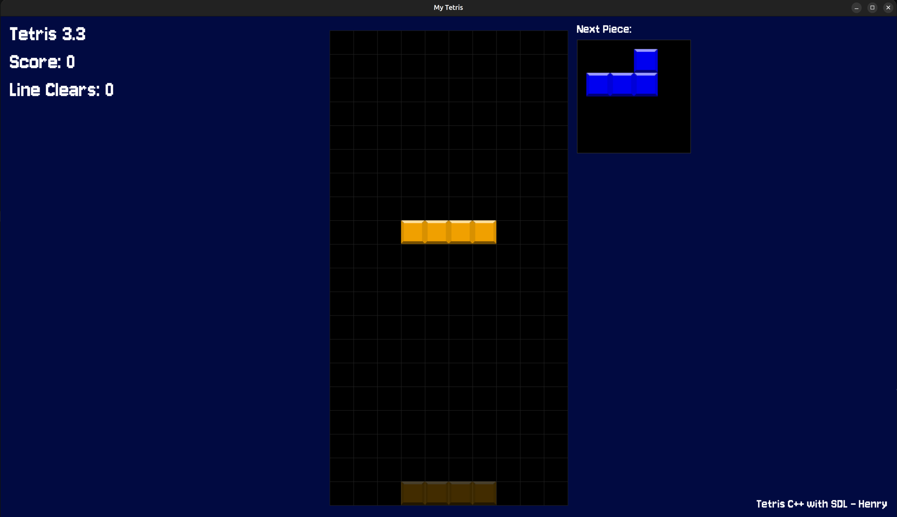

# C-Tetris

A classic Tetris clone written in modern C++20 using the **SDL3** library, created by Henry.



## Features

- **Classic & Custom Gameplay**: Features the standard 7 Tetrominoes (I, J, L, O, S, T, Z) with dynamic coloring and data-driven rule configuration via JSON (`data/`).
- **Modern Mechanics**: Super Rotation System (SRS) with full wall-kicks, ghost piece landing projection, hard drop, and a next-piece preview queue.
- **Audio System**: Background audio playlist management with track shuffling, volume adjustment, and dedicated UI sound effects.
- **NES/Classic Scoring**: Multi-line clear scoring that scales dynamically with speed and level progression.
- **Interactive UI & Menus**: Clean pause overlay, in-game interactive menus, sound triggers, and game-over state handling.

## Controls

| Key | Action |
| :--- | :--- |
| **Left / Right** | Move tetromino laterally |
| **Up** | Rotate clockwise (SRS) |
| **Down** | Soft drop |
| **Spacebar** | Hard drop (instant drop & lock) |
| **Escape** | Pause / Resume |
| **F1 / F2** | Master volume down / up |
| **Delete** | Quick exit to desktop |

---

## Prerequisites & Dependencies

To build and run this project, make sure you have:
- A C++20 compatible compiler (e.g., GCC 13+, Clang 16+, or MSVC 2022)
- [CMake](https://cmake.org/) (>= 3.20)
- [Ninja](https://ninja-build.org/) or GNU Make
- **SDL3** libraries:
  - `SDL3`
  - `SDL3_image`
  - `SDL3_mixer`
  - `SDL3_ttf`
- **nlohmann_json** (for parsing board states/configurations)

### Installing Dependencies (Ubuntu / Debian)
---
```bash
sudo apt update
sudo apt install -y build-essential cmake ninja-build git \
    libsdl3-dev libsdl3-image-dev libsdl3-mixer-dev libsdl3-ttf-dev \
    nlohmann-json3-dev
```

### Build using Cmake
---

```bash
# 1. Clone the repository
git clone [https://github.com/henryzcode/C-tetris.git](https://github.com/henryzcode/C-tetris.git)
cd C-tetris

# 2. Configure build environment
cmake -B build -G Ninja -DCMAKE_BUILD_TYPE=Release

# 3. Build the binary
cmake --build build -j$(nproc)
```
### Project structure
---
```
C-tetris/
├── assets/             # Game assets (sprites, textures, fonts, audio)
│   ├── music/          # Background BGM tracks
│   ├── sound/          # UI and gameplay SFX
│   ├── tiles/          # Tetromino block textures
│   └── pixel.ttf       # Font file
├── data/               # Game data, presets, and configs (.json)
├── headers/            # C++ header files (.hpp)
│   ├── entities.hpp
│   ├── game.hpp
│   ├── parse.hpp
│   ├── rules.hpp
│   └── ui.hpp
├── CMakeLists.txt      # CMake build definitions
└── *.cpp               # Core translation units (main, game, rules, parse, etc.)
```

### License
---
This project is licensed under the GNU General Public License v3.0 - see the [LICENSE](LICENSE) file for details.

### Acknowledgements
---
* **SDL3** for v3.x or newer version of Ctetris
* **SDL2** for older version of Ctetris
* **SDL-image**
* **SDL-ttf**
* **SDL-mixer**
* nlohmann/**json**
* **Cmake**
